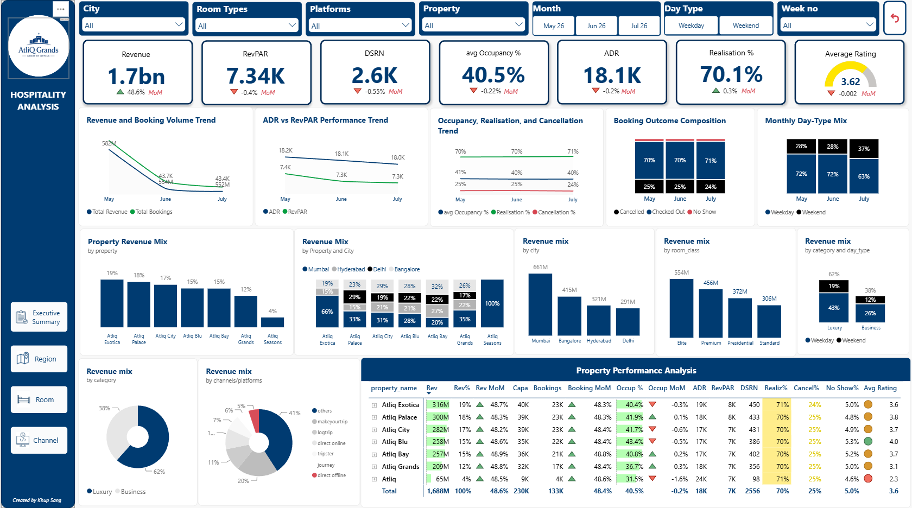
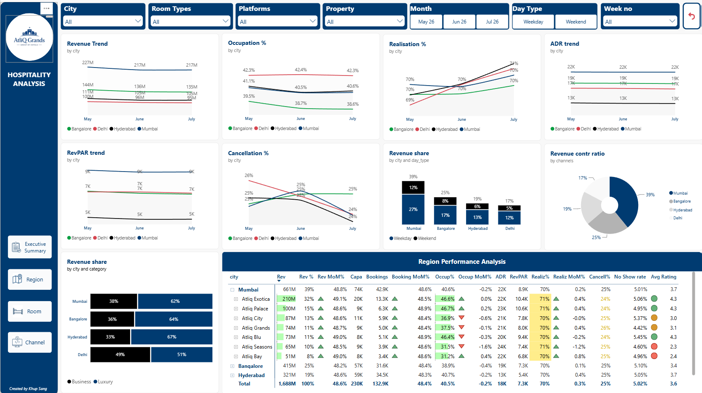
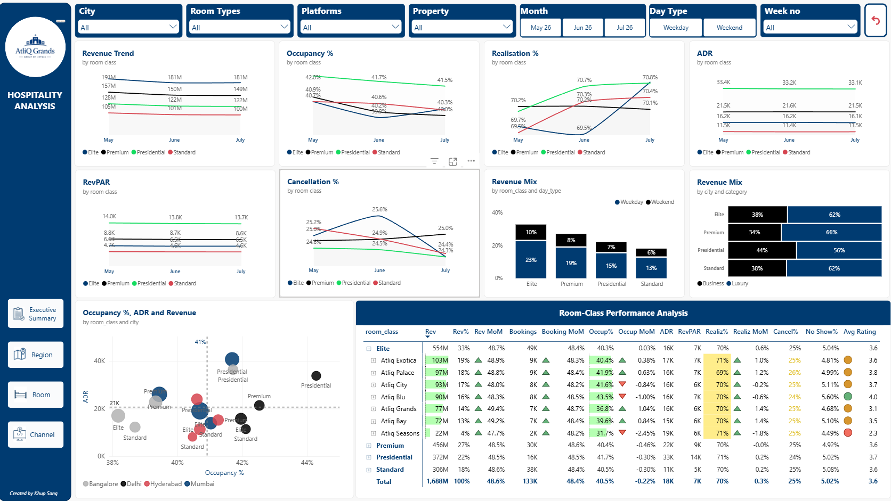
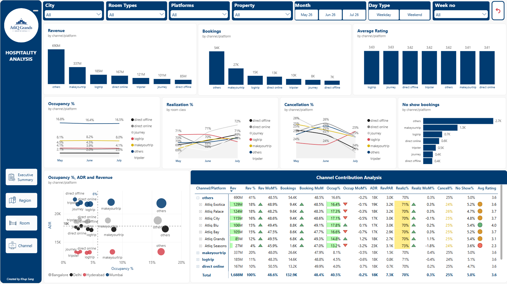

# 🏨 Hospitality Analytics Dashboard | Power BI

An interactive Power BI dashboard built to analyze hotel performance across properties, cities, room classes, and booking channels. The solution provides actionable insights into revenue generation, occupancy trends, pricing efficiency, booking behavior, and guest satisfaction.

---

## 📸 Dashboard Preview

### Executive Summary


### Region Analysis


### Room Analysis


### Channel Analysis


---

## 📌 Overview

This project analyzes hotel booking and operational data from **May–July 2025** for a fictional hospitality company operating across multiple cities in India.

The dashboard helps stakeholders monitor:

- Revenue performance
- Occupancy trends
- ADR & RevPAR
- Booking realization and cancellations
- Room-category performance
- Booking channel effectiveness
- Guest satisfaction

---

## 🛠️ Tech Stack

- **Power BI Desktop** – Dashboard development
- **Power Query** – Data cleaning & transformation
- **DAX** – KPIs, calculations, and business logic
- **Data Modeling** – Star schema approach
- **Conditional Formatting** – Performance indicators and trend analysis

---

## 📂 Data Source

The dashboard uses the Codebasics Hospitality Analysis Challenge dataset for AtliQ Grands representing a hotel chain operating across multiple cities in India.

### Fact Tables

#### fact_bookings
Individual booking-level transaction data.

| Column |
|----------|
| booking_id |
| property_id |
| booking_date |
| check_in_date |
| checkout_date |
| no_guests |
| room_category |
| booking_platform |
| ratings_given |
| booking_status |
| revenue_generated |
| revenue_realized |

#### fact_aggregated_bookings
Aggregated occupancy and capacity information.

| Column |
|----------|
| property_id |
| check_in_date |
| room_category |
| successful_bookings |
| capacity |

---

### Dimension Tables

#### dim_hotels

| Column |
|----------|
| property_id |
| property_name |
| category |
| city |

#### dim_rooms

| Column |
|----------|
| room_id |
| room_class |

#### dim_date

| Column |
|----------|
| date |
| mmm yy |
| week no |
| day_type |

---

### Data Model Overview

The project follows a **Star Schema** design:

```text
                 dim_date
                     │
                     │
                     ▼
            fact_bookings
                     ▲
                     │
    ┌────────────┬────────────┐
    │            │            │
    ▼            ▼            ▼
dim_hotels   dim_rooms   booking_platform

                     ▲
                     │
                     │
      fact_aggregated_bookings
                     │
                     ▼
               dim_hotels
```

**Key Relationships**
- `property_id` → connects hotel dimensions with booking facts.
- `room_category / room_class` → enables room-level analysis.
- `date fields` → support trend and time-series reporting.
- `booking_platform` → enables channel contribution analysis.
---

## 📊 Dashboard Pages

### 1️⃣ Executive Summary

Portfolio-level overview of hotel performance.

**Key KPIs**
- Revenue
- ADR
- RevPAR
- Occupancy %
- DSRN
- Realisation %
- Cancellation %
- Average Rating

**Key Visuals**
- Revenue & Booking Trend
- ADR vs RevPAR Trend
- Booking Outcome Analysis
- Revenue Mix by Property
- Revenue Mix by City
- Revenue Mix by Category

---

### 2️⃣ Region Analysis

Compare business performance across cities.

**KPIs**
- Revenue
- Occupancy %
- ADR
- RevPAR
- Realisation %
- Cancellation %
- Average Rating

**Key Visuals**
- Revenue Trend by City
- ADR & RevPAR Trend
- Occupancy Trend
- Revenue Share by Category
- Regional Performance Scorecard

---

### 3️⃣ Room Analysis

Analyze room-class performance and profitability.

**KPIs**
- Revenue
- Occupancy %
- ADR
- RevPAR
- Realisation %
- Cancellation %
- Average Rating

**Key Visuals**
- Room-Class Performance Matrix
- Revenue Mix by Room Class
- Occupancy Trend
- ADR Trend
- RevPAR Trend
- Room-Class Revenue Distribution

---

### 4️⃣ Channel Analysis

Evaluate booking channel effectiveness.

**KPIs**
- Revenue Contribution %
- Bookings
- Occupancy %
- ADR
- RevPAR
- Realisation %
- Cancellation %
- No-Show %
- Average Rating

**Key Visuals**
- Revenue by Channel
- Booking Volume by Channel
- Channel Performance Matrix
- Occupancy vs ADR Analysis
- Cancellation Trend
- Rating Comparison

---

## 📈 Key Metrics

| Metric | Formula |
|----------|----------|
| ADR | Revenue ÷ Rooms Sold |
| RevPAR | Revenue ÷ Available Rooms |
| Occupancy % | Checked-Out Bookings ÷ Capacity |
| Realisation % | Checked-Out Bookings ÷ Total Bookings |
| Cancellation % | Cancelled Bookings ÷ Total Bookings |
| Revenue Contribution % | Revenue ÷ Total Revenue |

---

## 💡 Key Insights

- Mumbai contributed the highest share of portfolio revenue.
- Luxury hotels generated more than 60% of total revenue.
- Elite rooms delivered the highest revenue contribution.
- Presidential rooms achieved the highest ADR and RevPAR.
- MakeMyTrip and Other channels drove the majority of bookings.
- Portfolio occupancy remained stable around 40%.
- Realisation rate averaged approximately 70%.
- Cancellation rate remained close to 25%, highlighting opportunities for revenue optimization.

---

## 🎯 Business Impact

This dashboard enables hotel stakeholders to:

- Monitor portfolio performance in real time
- Improve pricing and revenue strategies
- Optimize occupancy and RevPAR
- Evaluate channel effectiveness
- Reduce cancellations and no-shows
- Improve guest experience
- Support strategic decision-making

---

## 👨‍💻 Author

**Khup Sang**

Power BI • Data Analytics • 
